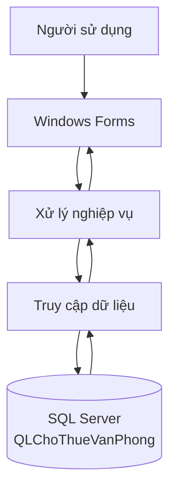

# LAB 8 – HỆ THỐNG QUẢN LÝ CHO THUÊ VĂN PHÒNG

Ứng dụng desktop hỗ trợ quản lý hoạt động cho thuê văn phòng trong một cao ốc. Hệ thống được xây dựng bằng **C# Windows Forms**, kết nối với **Microsoft SQL Server** và tổ chức dữ liệu theo các nghiệp vụ khách hàng, văn phòng, hợp đồng, dịch vụ, hóa đơn và thanh toán.

## 1. Mục tiêu đề tài

- Quản lý danh sách tầng, loại văn phòng và từng văn phòng trong cao ốc.
- Theo dõi trạng thái văn phòng: trống, đang giữ, đang thuê hoặc bảo trì.
- Quản lý thông tin khách hàng cá nhân và doanh nghiệp.
- Lập hợp đồng thuê với thời hạn tối thiểu 6 tháng.
- Tính tiền thuê phải trả trước trong 6 tháng đầu.
- Quản lý dịch vụ sử dụng theo từng hợp đồng.
- Quản lý hóa đơn tiền thuê, hóa đơn dịch vụ và các lần thanh toán.
- Thống kê tình trạng văn phòng, hợp đồng và doanh thu.

## 2. Công nghệ sử dụng

| Thành phần | Công nghệ |
|---|---|
| Ngôn ngữ | C# |
| Giao diện | Windows Forms |
| Nền tảng | .NET 8 |
| Cơ sở dữ liệu | Microsoft SQL Server Express |
| Kết nối dữ liệu | ADO.NET, Microsoft.Data.SqlClient |
| Môi trường phát triển | Microsoft Visual Studio |
| Quản trị cơ sở dữ liệu | SQL Server Management Studio |
| Vẽ sơ đồ | Mermaid, draw.io |

## 3. Chức năng chính

### Đăng nhập và phân quyền

- Kiểm tra tài khoản trong SQL Server.
- Hiển thị thông tin nhân viên và vai trò sau khi đăng nhập.
- Xử lý trường hợp nhập sai thông tin hoặc mất kết nối SQL Server.
- Đăng xuất và quay lại màn hình đăng nhập.

### Quản lý dữ liệu

- Tài khoản.
- Nhân viên.
- Khách hàng.
- Tầng và loại văn phòng.
- Văn phòng.
- Hợp đồng thuê.
- Dịch vụ và sử dụng dịch vụ.
- Hóa đơn.
- Thanh toán.

Các màn hình quản lý sử dụng `DataGridView` để hiển thị dữ liệu, hỗ trợ tìm kiếm và làm mới danh sách.

### Báo cáo – thống kê

- Số lượng văn phòng đang trống.
- Số lượng văn phòng đang cho thuê.
- Số hợp đồng đang có hiệu lực.
- Tổng doanh thu đã ghi nhận.
- Thống kê văn phòng theo trạng thái.

## 4. Kiến trúc chương trình



Các thành phần chính của mã nguồn:

```text
QLChoThueVanPhong
├── Forms
│   ├── FrmDangNhap.cs
│   ├── FrmMain.cs
│   ├── FrmBaoCaoThongKe.cs
│   └── Các Form quản lý dữ liệu
├── Infrastructure
│   ├── DatabaseHelper.cs
│   └── DbSettings.cs
├── Ui
│   └── UiTheme.cs
├── Utilities
│   └── SessionManager.cs
├── Program.cs
├── QLChoThueVanPhong.csproj
└── QLChoThueVanPhong.sln
```

## 5. Thiết kế cơ sở dữ liệu

Cơ sở dữ liệu có tên `QLChoThueVanPhong`, gồm 12 bảng:

| STT | Tên bảng | Nội dung quản lý |
|---:|---|---|
| 1 | TaiKhoan | Thông tin đăng nhập và vai trò |
| 2 | NhanVien | Thông tin nhân viên |
| 3 | KhachHang | Cá nhân hoặc doanh nghiệp thuê |
| 4 | Tang | Các tầng trong cao ốc |
| 5 | LoaiVanPhong | Loại và đặc điểm văn phòng |
| 6 | VanPhong | Thông tin từng văn phòng |
| 7 | HopDong | Hợp đồng thuê văn phòng |
| 8 | DichVu | Danh mục dịch vụ |
| 9 | SuDungDichVu | Dịch vụ sử dụng theo kỳ |
| 10 | HoaDon | Hóa đơn tiền thuê và dịch vụ |
| 11 | ChiTietHoaDon | Các khoản chi tiết của hóa đơn |
| 12 | ThanhToan | Các lần thanh toán |

Stored procedure `sp_LapHopDong` sử dụng transaction để thực hiện đồng thời:

1. Kiểm tra thời hạn thuê tối thiểu 6 tháng.
2. Kiểm tra văn phòng còn trống.
3. Tạo hợp đồng thuê.
4. Tạo hóa đơn trả trước 6 tháng.
5. Chuyển văn phòng sang trạng thái `DANG_GIU`.
6. Rollback toàn bộ thay đổi nếu xảy ra lỗi.

## 6. Yêu cầu cài đặt

Máy tính cần có:

- Windows 10 hoặc Windows 11.
- Microsoft Visual Studio với workload **.NET desktop development**.
- .NET 8 SDK hoặc runtime.
- SQL Server Express.
- SQL Server Management Studio.
- Git nếu muốn quản lý mã nguồn bằng Visual Studio.

## 7. Hướng dẫn cài đặt cơ sở dữ liệu

1. Mở SQL Server Management Studio.
2. Kết nối tới instance:

```text
.\SQLEXPRESS
```

3. Mở file `Chuong4_SQL_Server.sql`.
4. Nhấn **Execute** để tạo database, bảng, ràng buộc và dữ liệu mẫu.
5. Kiểm tra database `QLChoThueVanPhong` trong Object Explorer.

Nếu database được tạo từ bản script cũ, có thể cập nhật mật khẩu thực hành bằng câu lệnh:

```sql
USE QLChoThueVanPhong;

UPDATE TaiKhoan
SET MatKhauHash = '123456'
WHERE TenDangNhap IN ('admin', 'nhanvien01');
```

## 8. Hướng dẫn chạy chương trình

1. Mở file `QLChoThueVanPhong.sln` bằng Microsoft Visual Studio.
2. Kiểm tra chuỗi kết nối trong `Infrastructure/DbSettings.cs`:

```csharp
Server=.\SQLEXPRESS;
Database=QLChoThueVanPhong;
Integrated Security=True;
TrustServerCertificate=True;
```

3. Chọn **Build → Rebuild Solution**.
4. Nhấn **F5** để chạy chương trình.
5. Đăng nhập bằng tài khoản mẫu:

```text
Tên đăng nhập: admin
Mật khẩu: 123456
```

## 9. Kiểm thử

Hệ thống được kiểm thử với các nhóm Test Case:

- Đăng nhập đúng, sai và bỏ trống dữ liệu.
- Mất kết nối SQL Server.
- Mở và chuyển đổi giữa các Form.
- Hiển thị, tìm kiếm và làm mới dữ liệu.
- Lập hợp đồng hợp lệ.
- Từ chối hợp đồng dưới 6 tháng.
- Từ chối văn phòng không còn trống.
- Kiểm tra rollback khi transaction phát sinh lỗi.
- Hiển thị báo cáo và số liệu thống kê.

## 10. Hình ảnh minh họa

Có thể bổ sung ảnh chụp vào thư mục `Screenshots` và thay các dòng bên dưới bằng đường dẫn ảnh thực tế:

```markdown


```

## 11. Tài liệu kèm theo

- Báo cáo Word gồm 6 chương.
- Script tạo cơ sở dữ liệu SQL Server.
- Sơ đồ Use Case, Class, Activity, Sequence và sơ đồ quan hệ CSDL.
- Bảng Test Case và kết quả kiểm thử hệ thống.

## 12. Tác giả

- GitHub: [1250080061-ui](https://github.com/1250080061-ui)
- Repository: [LAB_AT_OOSD](https://github.com/1250080061-ui/LAB_AT_OOSD)

---

Đây là sản phẩm thực hành LAB 8 thuộc đề tài **Quản lý cho thuê văn phòng ở cao ốc**.
